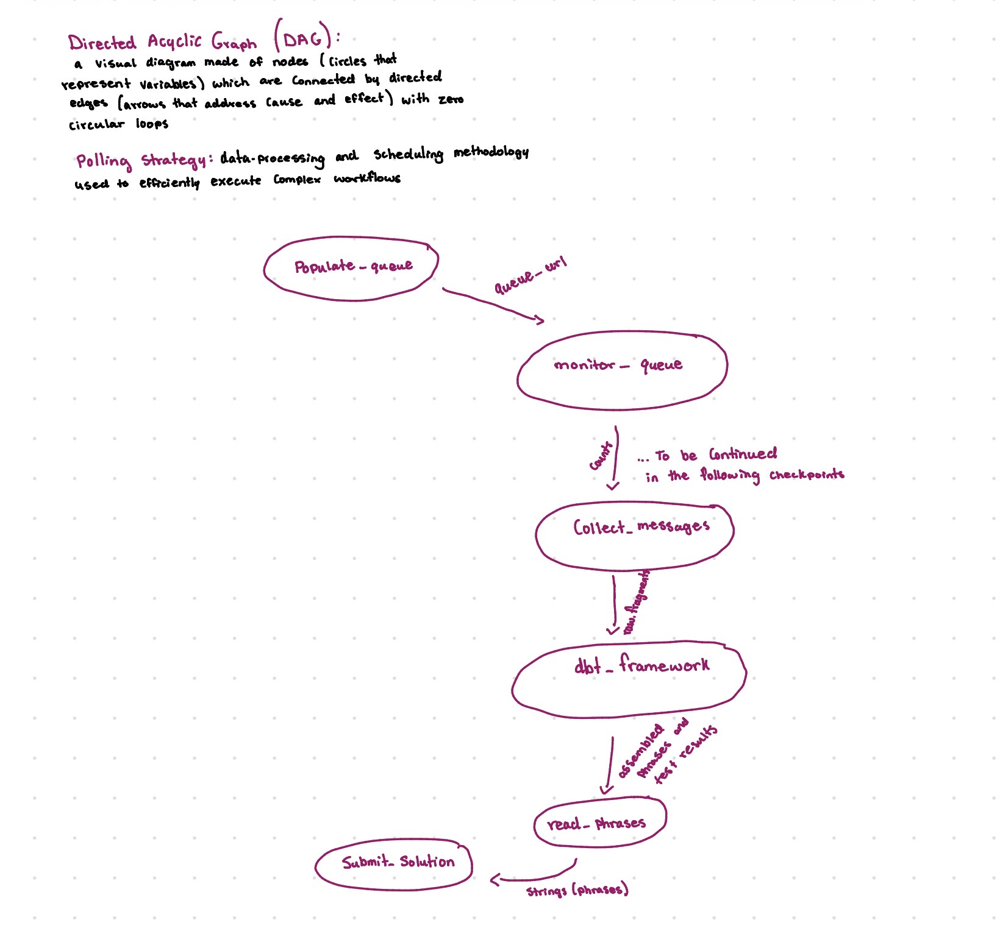
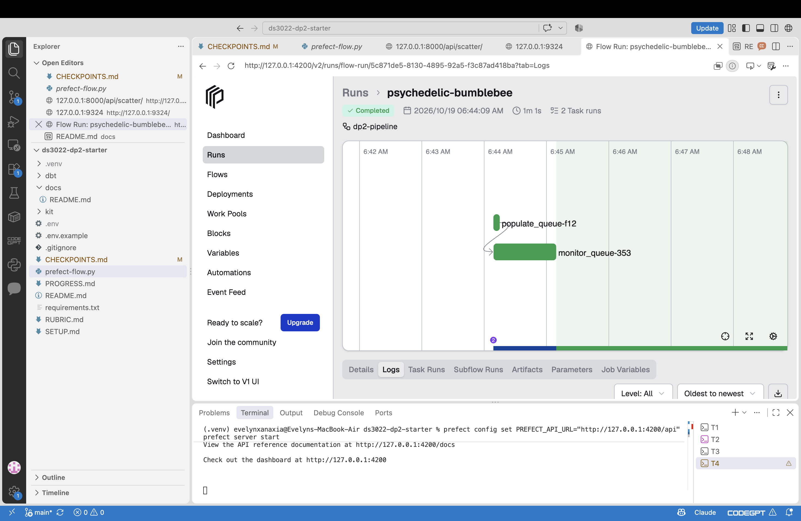
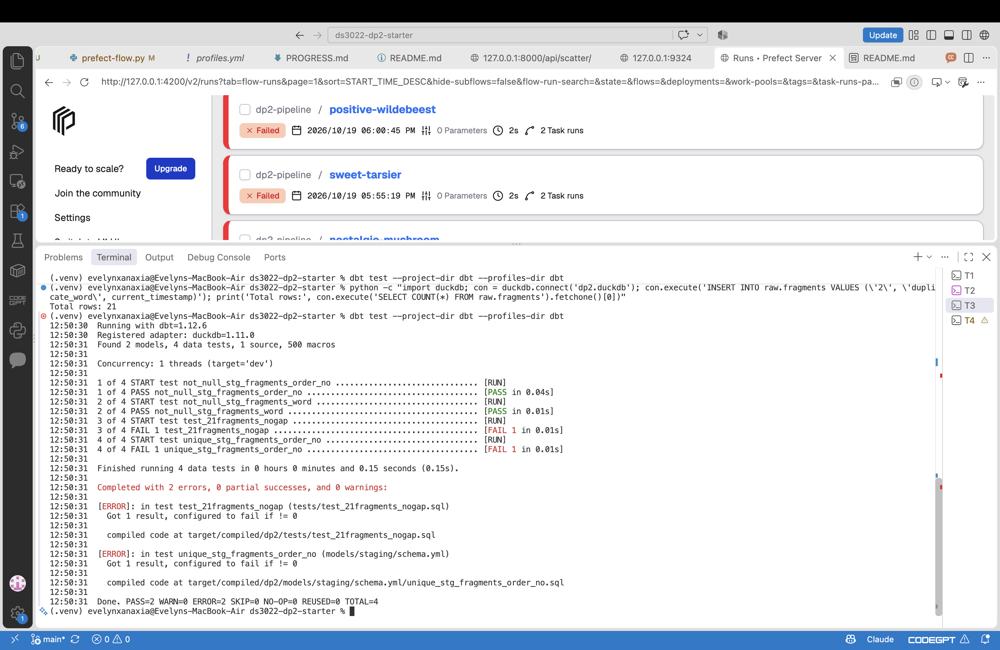
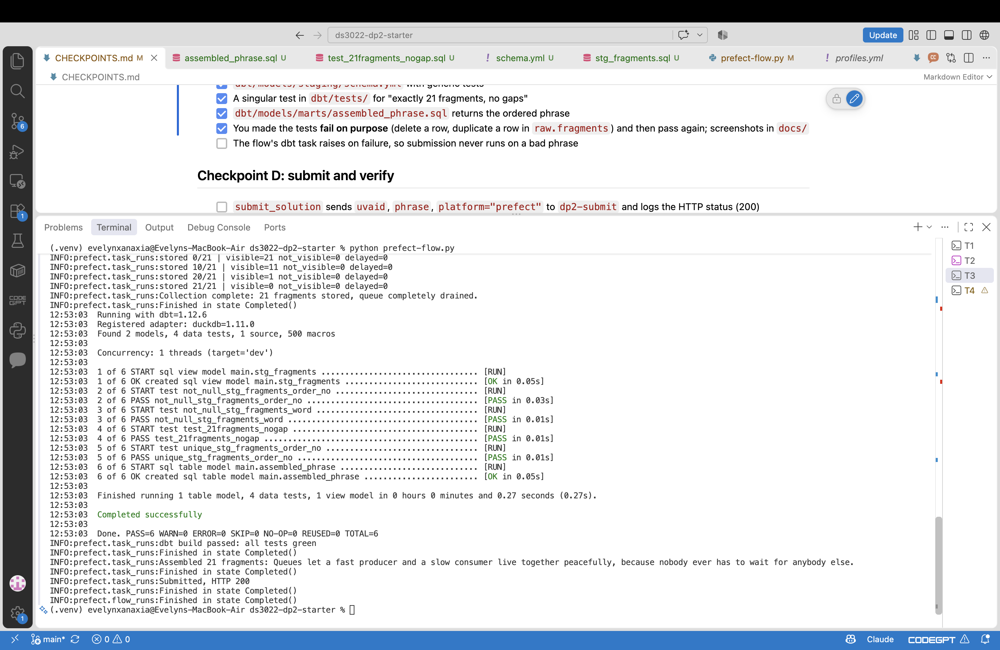
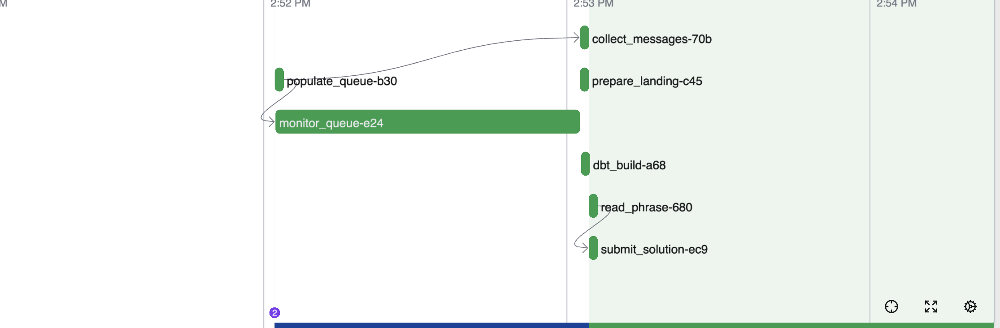

Put your DAG sketch (`dag.jpg`), dashboard screenshots and dbt test screenshots here.

# SQS Puzzle

This project takes twenty-one words that arrive in a queue, which are also out of order and on random timers. My Prefect flow collects these words, uses dbt to check them, and then put them into a sentence back together.

## Set Up +  Run Pipeline

1. Fork and clone this reposotiory in Github: 
https://github.com/evelynxanaxia/ds3022-dp2-starter.git
2. Double check you are in the ds3022-dp2-starter.git repository once in terminal.
2. Once cloned ensure that you have four terminals up and create a virtual envoirnment, once in the virtual envoirnment install requirements.txt.
3. Create an .env where you will copy everything in .env.example, the only difference will be that you will replace the UVA_ID = ***** with your own student ID.

4. Once this is done you in T1 (terminal 1) you must start the emulator you will be using --> moto_server -p 9324
5. T2 (terminal 2) you have to start the scatter API  --> python3 (or whatever python version you have) kit/scatter_api.py
7. T3 (terminal 3) run a test to ensure you have all you need --> python3 (or whatever python version you have) kit/smoke_test.py, everything should say 'OK' if not go back to the previous steps and make sure everything was done correctly.

8. In T4 (terminal 4) you will activate your prefect server --> prefect server start
9. In T3 (terminal 3) start the python file --> python3 prefect-flow.py

## Pipeline Order

The pipeline works strictly in this **(Receive → Persist → Delete)** sequence:
1. Delivery: SQS ensures that messages are delivered at least once (but redeliveries can occur) and they are recieved. 
2. If the worker crashes after writing a fragment to DuckDB but before calling `delete_message`, the message's visibility timeout will expire and SQS will redeliver it on the next run, so it will still be seen.
3. Idempotent Defense: In staging `SELECT DISTINCT` is employed and so is partition deduplication. This means that anything that is redelivered does not create duplicate rows downstream, therefore no issues can arise. 
4. Why Not Delete First: Like talked about in class if we called `delete_message` before landing the record in DuckDB, an unexpected crash would result in permanent data loss, which would then cause the final sentence assembly to fail because of the lack of data.
## DAG Sketch

## Prefect Dashboard Run

## Polling Strategy
The pipeline implements an active polling mechanism using boto3 (`get_queue_attributes`) to query three key SQS queue metrics:
- `ApproximateNumberOfMessages`
- `ApproximateNumberOfMessagesNotVisible`
- `ApproximateNumberOfMessagesDelayed`

The `monitor_queue` task inspects these counters at regular intervals (`poll_s=5`). It blocks downstream processing until `ApproximateNumberOfMessagesDelayed == 0`, ensuring all fragments have been released into the queue, then a timeout ceiling (`timeout_s=1200`) guards against my function running for a long time.

 ### Polling Strategy Alternatives Rejected
Fixed Sleep Alone:  Sleeping for a specific amount of time would either waste runtime or risk to reading something before delayed messages can even become visible meaning that the function wouldn't recieve the actual word.

The `populate_queue`  and `monitor_queue`take the inputs of the UVA_ID and the scatter URL from the .env folder, which then ouputs the queue URL. One thing to keep in mind is that you should not re-run these tasks after the collecting has begun because doing this would empty the queue.

The  `collect_messages` task takes the queue URL as an input and successfully outputs 21 read rows in the raw.fragments. Afterwards the system ensures that no more items that need to be read remain. Therefore the queue is empty. This task can be rerun because it saves things before deleting anything and retrying it would only show what is left in the queue, which should be nothing if the task read everything in the queue.

 `dbt_build` uses the raw.fragments (unorganized words) as an input and then outputs them assembled. The task ensures that the test results are accurate and that no fragments that are needed are missing. This task  cannot be rerun in case of an error because it wouldn't change the answer. If there is an error at this task review the ones before.

 The `read_phrase` task takes the assembled phrases from  `dbt_build`and returns the phrases as strings, which classifies them as text. This task can be rerun but there's really no need because it can only run if  `dbt_build` ran before this task, so if there's any errors it would most likely come from  `dbt_build`.

Lastly the  `submit_solution`task takes the phrases and UVA_ID as inputs and outputs the HTTP status link/ If there is an error like a netwrok glitch it can be rerun so that it returns a working link.

 

## How DBT Protects Results

In an event of queue architecture, a pipeline cannot safely assume that input records arrive intact, ordered, or without loss. Downstream consumers will blindly process whatever data lands in DuckDB, which can lead to silent data corruption.
Dbt tests are used to prevent this:
1. `unique` and `not_null` on `order_no`:
Ensures that every position in the target sequence exists once and only once.
   They also prevent duplicate fragments from colliding and eliminate null keys that would disrupt sentence indexing.

2. `not_null` on `word`:
  Makes sure that every positioned slot carries an actual string rather than just an empty or dropped value.

3. `test_21fragments_nogap` : This verifies structural completeness by checking that the distinct count of fragments is exactly 21 and that there are zero sequence gaps between 1 and 21.

## Dbt Protection Failure

This run failed because I deleted a row and duplicated another. That is why it says the fragments_order_no and unique_stg_fragments_order_no did not pass.   

## Pass After Failure

After I reran the `prefect-flow.py` file I removed the purposely implemented failures and the file passes perfectly.

## Full Delay Run

`DP2_FAST=0`

### Recipt Code:

PASS  ****** / prefect  receipt: 618B9FF3BE

## Chaos Round

#### What broke:

My `collect_messages`function failed because I didn't have the code neccessary to handle the inputs of the chaos round.
#### Why:

The chaos round implements two types of disruptive payloads into the queue (duplicate and malformed messages)

Duplicate messages: Messages with identical `order_no` and word values or re-sent duplicates with different receipt handles.

Malformed messages: Messages missing attributes entirely, payloads with garbage strings, or non-numeric `order_no` values.

#### How I fixed it:

I updated my function to validate the presence and numeric format of `order_no` and `word` using safe `.get()` lookups. Malformed messages are logged and archived into `raw.rejects`.  I made sure that duplicate messages are counted once and malformed messages are logged/ stored and deleted afterwards so that nothing is left in the queue.

## Tool Roles and System Trade-offs

**Prefect**: 
- Helps run task dependencies, turns python functions into reliable pipelines
-  provides execution monitoring, retries, and coordinates the flow from queue polling (this means that even if a task fails prefect will automatically retry it instead of crashing everything immidietaly)
- Dropping prefect would require more manual work, immiediate need for changes if a function doesn't run and would require us to track everything on our own

**DuckDB**: 

- Can run SQL queries locally without any need for another server database
- Dropping DuckDB would require us to manually keep the data in an external database servers (like PostgreSQL/Snowflake)

**dbt**: 

- Manages data transformation, staging lineage (using functions to map an automatic DAG), and declarative testing gates (like `unique`, `not_null`)
- *Dropping dbt* would require embedding raw SQL transformation and manual validation assertions directly inside Python

 **Overall**: Using these tools allows our project to flow more organized, protected and faster as opposed to having to do what they do manually. Not only would it require more manual work, but also the use of more databases that would require more time to install and connect and possibly leave more space for disruptions.

## Citations

https://www.getdbt.com/blog/what-exactly-is-dbt

https://dev.to/vijayrodrigues/what-is-dbt-a-no-fluff-guide-for-data-engineers-and-analysts-32k5

https://docs.prefect.io/v3/get-started/quickstart

https://duckdb.org/why_duckdb

https://www.getdbt.com/blog/dag-use-cases-and-best-practices